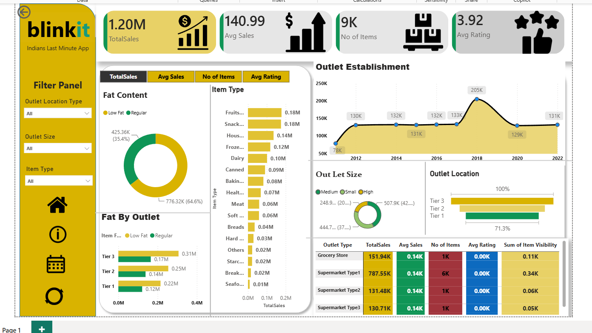

# Blinkit Sales Analysis Dashboard | Power BI

An interactive business intelligence dashboard built using **Microsoft Power BI, DAX, and Excel** to analyze Blinkit's sales performance, product categories, and outlet characteristics.

## 📊 Dashboard Preview

## 🎯 Project Objectives

- Analyze overall sales performance using key performance indicators.
- Identify sales patterns across different item categories.
- Compare sales by product fat content.
- Evaluate outlet performance by establishment year, size, location, and type.
- Present business metrics through interactive visualizations and filters.

## 🛠️ Tools & Technologies

- **Microsoft Power BI** — Dashboard development and data visualization
- **DAX** — Measures and business calculations
- **Microsoft Excel** — Dataset preparation and data cleaning

## 📈 Key Performance Indicators

| KPI | Value |
|---|---:|
| Total Sales | 1.20M |
| Average Sales | 140.99 |
| Number of Items | Approximately 9K |
| Average Rating | 3.92 |

*Values are based on the dashboard and may be rounded.*

## 📌 Dashboard Features

- **KPI Cards:** Overview of total sales, average sales, number of items, and average rating.
- **Fat Content Analysis:** Comparison of sales for low-fat and regular products.
- **Item Type Analysis:** Sales comparison across product categories.
- **Outlet Establishment Trend:** Analysis of sales across outlet establishment years.
- **Outlet Size Analysis:** Comparison of sales across different outlet sizes.
- **Outlet Location Analysis:** Comparison of outlet performance across location tiers.
- **Outlet Type Comparison:** Tabular view of sales, average sales, item counts, ratings, and item visibility.
- **Interactive Filters:** Filter the dashboard by outlet location type, outlet size, and item type.

## 💡 Business Questions

This dashboard helps explore the following questions:

1. What are the overall sales and average sales?
2. Which item categories contribute the most to total sales?
3. How do sales differ between low-fat and regular products?
4. How does sales performance vary across outlet establishment years?
5. How do outlet size and location relate to sales performance?
6. How do different outlet types compare across key metrics?

## 📁 Project Files

| File | Description |
|---|---|
| `BLINKIT powerbi project.pbix` | Interactive Power BI report |
| `BlinkIT Grocery Data.xlsx` | Excel dataset used for analysis |
| `dashboard.png` | Dashboard preview |
| `Avg Sales.png` | Average sales visual asset |
| `Items.png` | Items visual asset |
| `Sales.png` | Sales visual asset |
| `rating (1).png` | Rating visual asset |
| `background kpi.png` | KPI background visual asset |

## 🚀 How to Use

1. Download the Power BI report (`.pbix`) from this repository.
2. Open the file using Microsoft Power BI Desktop.
3. Explore the dashboard using the interactive filters and visualizations.
4. Review the sales metrics and compare outlet and product performance.

## 📌 Conclusion

The dashboard brings key sales metrics and outlet performance indicators into a single interactive report, supporting the exploration of product-level and outlet-level sales patterns.

**Project: Blinkit Sales Analysis  
**Category:Data Analytics | Business Intelligence  
**Primary Tool: Microsoft Power BI
